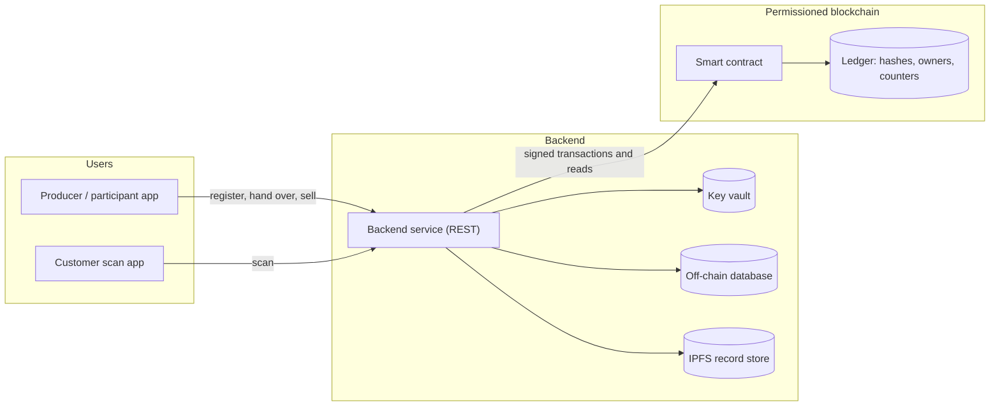
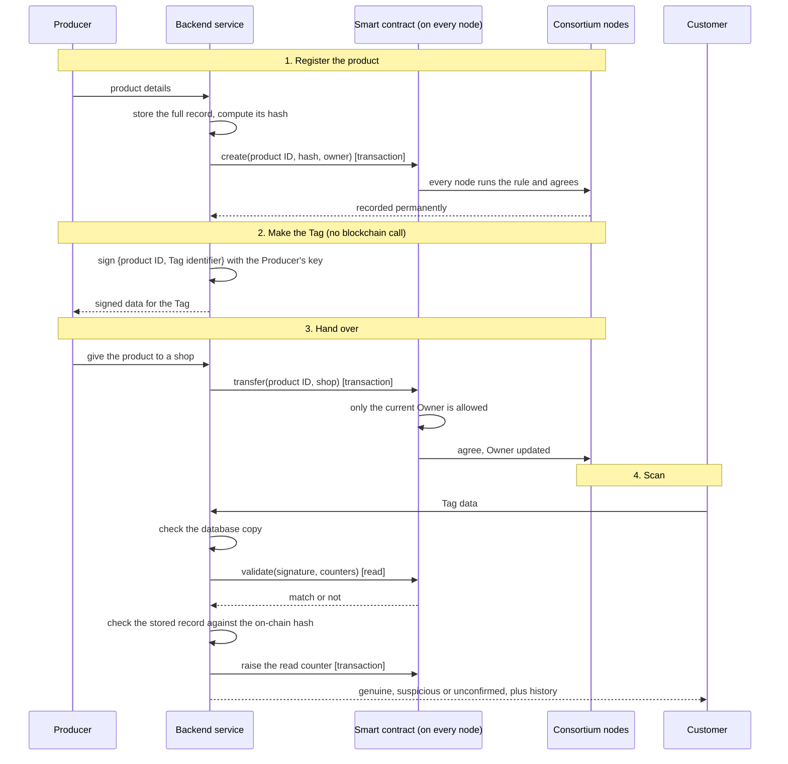
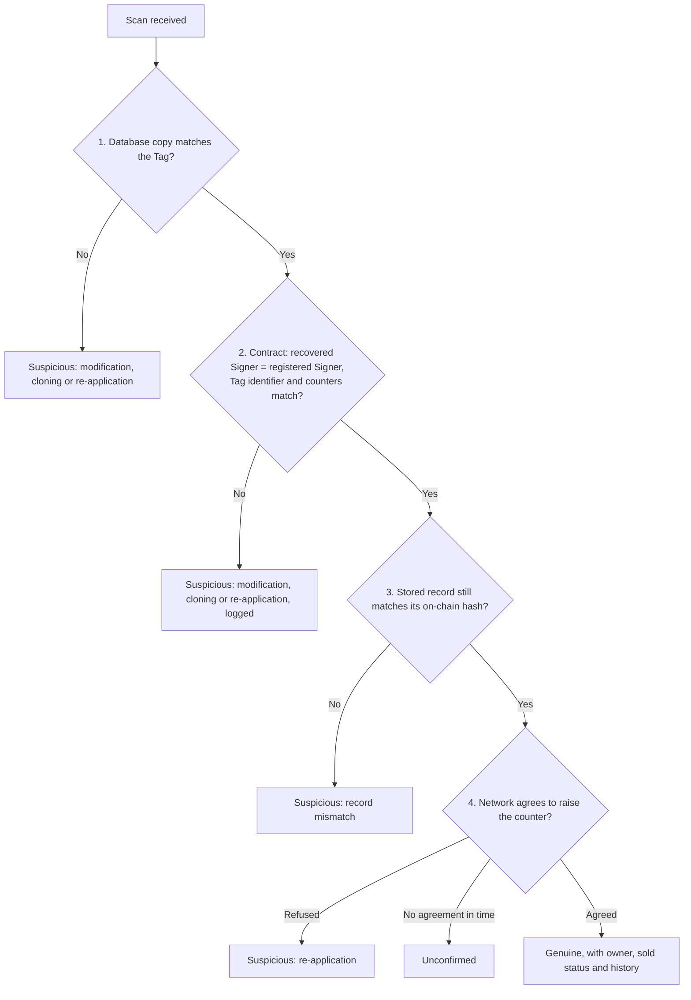
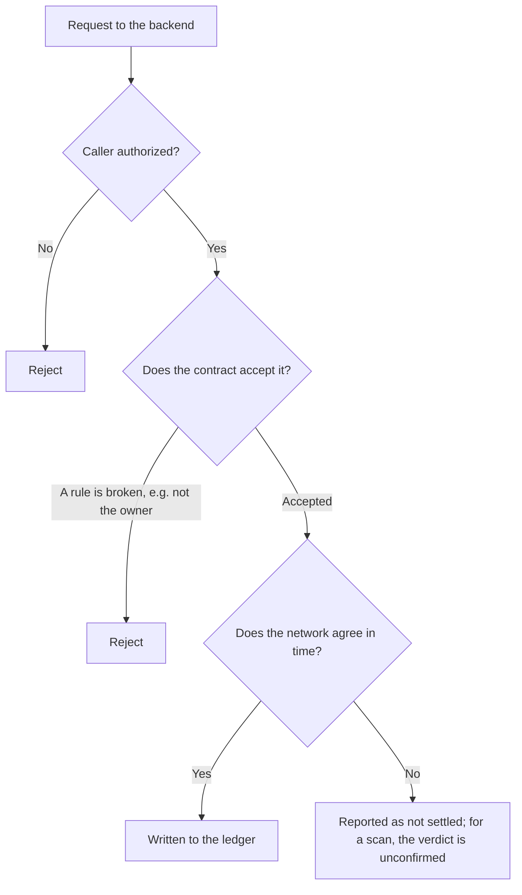
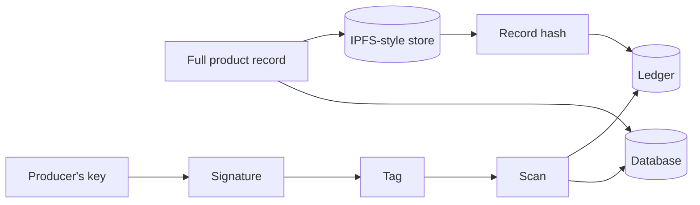

# Blockchain-Based Product Authenticity Checker: Design Explained

This document explains the design of a system that lets a buyer check whether a product is genuine. It starts from the problem, introduces the ideas the design rests on, and then walks through how the system works, step by step, with diagrams and a worked example. No prior knowledge of blockchain is assumed.

Related documents:

- [IMPLEMENTATION.md](IMPLEMENTATION.md): how the working demo is built, file by file.
- [INSTALLATION.md](INSTALLATION.md): how to install and use the demo.
- [GLOSSARY.md](GLOSSARY.md): the project's vocabulary. Capitalised terms in this document (Producer, Signer, Signed label and so on) are defined there.

## Contents

1. Overview
2. The problem and the objectives
3. What the system does, and what it does not
4. The research behind the design
5. Core ideas in brief
6. System architecture
7. Architecture diagram
8. The complete flow
9. How the blockchain is used in each step
10. Detailed flow diagrams
11. Design decisions and why
12. A worked example
13. Failure scenarios and edge cases
14. Limitations and risks
15. From the design to the demo
16. Choices a real deployment must make
17. Check your understanding
18. The whole system in five minutes
- Appendix A: Sources
- Appendix B: Blockchain basics

---

## 1. Overview

**The system in one paragraph.** A Producer registers each product on a ledger that several independent organizations share. Each product carries a **Tag** whose contents are digitally signed by the Producer. When a Customer scans the Tag, a server checks the signature and a counter, compares the product's stored record with its fingerprint on the shared ledger, and answers: is this product registered, who holds it now, has it already been sold, and what is its history?

**The idea in three parts.**

1. **A signed Tag** proves who made the label and exposes edits to it.
2. **A shared record** that no single company can rewrite quietly holds the facts that must not change: which products exist, who owns them, a fingerprint of each product's details, and how many times each Tag has been read.
3. **Layered checks** compare the Tag, the server's records and the shared record on every scan. If they disagree, the product is flagged.

---

## 2. The problem and the objectives

**The problem.** Counterfeit goods look like real ones. Plain barcodes, QR codes and NFC or RFID tags can be copied, so a copied code on a fake product can pass a simple check. The research the design builds on (Yiu, "Toward Blockchain-Enabled Supply Chain Anti-Counterfeiting and Traceability") names three common attacks on systems run by a single company:

| Attack | What the attacker does |
| --- | --- |
| **Modification** | Changes the data stored on a Tag, for example the product identifier |
| **Cloning** | Copies a genuine Tag's data onto another chip, which is then put on a fake product |
| **Re-application** | Reuses a genuine Tag's data or moves a genuine Tag onto a different product |

**Why it matters.** An OECD and EUIPO press release (7 May 2025) estimates counterfeit trade at about USD 467 billion in 2021, or 2.3% of global imports. The figure is taken from the press release; the full report was not consulted.

**Objectives.**

1. Let a buyer check a product's origin, current owner and history.
2. Make that history hard to rewrite afterward.
3. Detect modified, copied and re-applied Tags wherever the data allows it.
4. Keep the design simple enough to demonstrate end to end.

---

## 3. What the system does, and what it does not

| It does | It does not |
| --- | --- |
| Register products and record every change of owner | Inspect the physical item |
| Sign Tags and check each scan against them | Stop someone moving a genuine Tag onto a fake item |
| Expose edits to a stored product record | Make wrong data right: it records faithfully whatever an approved party enters |
| Show a product's history and the failed checks logged against it | Work without trusting the organizations that enter the data |

The second column is not a list of missing features; it is the limit of what any ledger can prove (see the oracle problem in section 5).

---

## 4. The research behind the design

The design combines ideas from four papers. Each contributes one layer of the system.

| Paper | Type | What the design takes from it |
| --- | --- | --- |
| **Ho Dac et al.**, "A practical blockchain-based framework for anti-counterfeiting and traceability", *CTU Journal of Innovation and Sustainable Development* 15 (2023) | Peer-reviewed journal | The **product lifecycle** (register, hand over, sell, check), the roles, and the rules: only an approved Producer registers, only the owner hands over, a sold item cannot be sold again |
| **Yiu**, "Decentralizing Supply Chain Anti-Counterfeiting Systems Using Blockchain Technology" ("dNAS"), arXiv:2102.01456 (2021) | Preprint | The **signed Tag** with write and read counters; the **layered check** (database, chain, stored record); the error names modification, cloning and re-application; keeping the full record off-chain and only its hash on-chain; a key vault; a permissioned consortium |
| **Musamih et al.**, "A Blockchain-Based Approach for Drug Traceability in Healthcare Supply Chain", *IEEE Access* 9 (2021) | Peer-reviewed journal | **Authorization checks** so only permitted callers can run a function, and the **hash-on-chain, data-off-chain** split |
| **Yiu**, "Toward Blockchain-Enabled Supply Chain Anti-Counterfeiting and Traceability", arXiv:2102.00459 (2021) | Preprint | The **threat analysis**: the three attack types above, and the argument that a single company's system is a single point of trust |

**Where each paper stops, and how the others fill the gap.**

| Gap in one paper | How the design covers it |
| --- | --- |
| Ho Dac et al. check a barcode, which is easy to copy | The signed Tag and counters from dNAS replace the barcode |
| Ho Dac et al. measured speed (63 to 88 blocks a minute, with 20 nodes on one PC) but did not test attacks | The attack types from the Toward paper become the test cases |
| dNAS is a research prototype for the wine industry | The same checks are applied to a general product |
| Musamih et al. target drug tracing on Ethereum | Only their two general ideas are kept (owner-only functions, hash on-chain and data off-chain) |

**Background reading.** The oracle problem is discussed by Caldarelli, Rossignoli and Zardini (*Sustainability* 12, 2020) and by Powell, Foth, Cao and Natanelov ("Garbage in garbage out: the precarious link between IoT and blockchain in food supply chains"). Platform behaviour is taken from the official Ethereum smart-contract documentation and the Hyperledger Fabric documentation. Full citations are in Appendix A.

**How the papers were used.** Ho Dac et al. was read in full. For dNAS, the system model, architecture, implementation and validation sections were read. For Musamih et al. and the "Toward" paper, the implementation, evaluation, threat-analysis and limitation sections were read. Statements about those papers are limited to what those sections say.

---

## 5. Core ideas in brief

Appendix B explains each idea from scratch. This section is a quick reference.

| Idea | In one or two sentences |
| --- | --- |
| **Blockchain** | A record book copied across many computers. Entries are grouped into blocks, and each block carries the fingerprint (hash) of the one before it, so editing an old entry breaks the chain and is noticed |
| **Permissioned chain** | Only approved organizations may take part, and their identities are known. The alternative, a public chain, lets anyone join. dNAS builds a permissioned network on Ethereum software with Proof-of-Authority (or Quorum with IBFT consensus); Ho Dac et al. use Hyperledger Fabric |
| **Smart contract** | A program stored on the chain that enforces rules, such as "only the current owner may hand a product over". Fabric calls these *chaincode*; Ethereum contracts are written in Solidity |
| **Node, ledger, consensus** | A node is a computer holding a copy of the ledger. Consensus is the rule by which nodes agree which entries count and in what order. Every node re-runs each rule itself, so one machine cannot fake a result |
| **Transaction vs read** | A *transaction* changes the ledger: it is signed, agreed by the network and stored for good. A *read* only looks at the ledger, is answered by **one** node, and changes nothing |
| **Hash** | A fixed-length fingerprint of data. Change one letter and the fingerprint changes completely |
| **Digital signature** | A stamp made with a private key. Anyone with the matching public key can check who made it and that the data is unchanged. It does not hide the data |
| **Off-chain storage (IPFS)** | A place for large or private data. Only the data's hash goes on the chain, which keeps the chain small |
| **NFC and QR** | Two ways to carry data on a product. A QR code is a printed picture. An NFC chip can be read by a phone, can hold a counter that changes on every read, and (on some chips) can be rewritten |
| **Tag counters** | A **write counter** (how often the Tag was written) and a **read counter** (how often it was scanned). The Tag, the server and the chain each keep a copy, and a mismatch signals a copied or replayed Tag |
| **Oracle problem** | A ledger can show that a record was not changed after it was written, but not that the record matches the physical object. A genuine Tag stuck on a fake bottle still reads "genuine" |

---

## 6. System architecture

| Component | Purpose | Draws on |
| --- | --- | --- |
| **Permissioned blockchain** | Holds the shared record (record hash, owner, history, counters) and runs the contract rules | Ho Dac et al., dNAS, Musamih et al. |
| **Smart contract** | Enforces who may register, hand over and sell, and validates scanned Tags | Ho Dac et al. (flows), dNAS (validation), Musamih et al. (authorization) |
| **Consortium and identity** | Only organizations approved by the Administrator may write | Ho Dac et al., dNAS |
| **Backend service** | The only part that talks to the chain: signs and submits transactions, answers scans | dNAS (its "blockchain service") |
| **Key vault** | Holds each party's signing key | dNAS |
| **Off-chain record store** | Holds each full product record (a database and an IPFS-style copy); only the hash goes on-chain | dNAS, Musamih et al. |
| **Tag** | Carries the signed label and the counters (an NFC chip) | dNAS |
| **Applications** | A Producer and shop interface, and a Customer scan interface | dNAS |

**Roles.**

| Role | Does |
| --- | --- |
| **Administrator** | Approves organizations (Producers, Participants) and nodes |
| **Producer** | Makes products, is the first Owner, and is the **Signer** of each product's Tag |
| **Participant** | Receives products after the Producer (a supplier or shop) |
| **Customer** | Buys a product and scans its Tag |
| **Validator node** | Takes part in agreeing new blocks |

The source papers use their own role names (for example "winemaker", "retailer", "certifying agency"); the design merges them into the four above.

**The data.**

| Where | What is stored |
| --- | --- |
| **On the Tag** | The **Signed label** (Product ID and Tag identifier, the chip's serial number), the **Signature** over it, the **write counter** and the **read counter**. Only the Signed label is signed; the read counter is not, because it changes on every scan |
| **On the chain** | For each product: the Record hash, the registered Signer, the Owner, the Tag identifier, both counters, the status (registered or sold), the history, and a log of failed checks |
| **On the server** | The full Product record (database and IPFS-style copy), a copy of the Tag as issued, the signing keys, and how to reach the contract (its address and function list) |

---

## 7. Architecture diagram



**How to read it.**

1. Users never talk to the blockchain directly. They go through the backend service.
2. The service fetches signing keys from the vault, keeps full records off-chain, and sends signed transactions to the contract. It also asks the contract read-only questions.
3. The contract checks the rules and reads or writes the ledger.
4. The ledger is held by every node of the consortium, not by the server.

---

## 8. The complete flow

Each step names what triggers it, which component acts, what it does, and why it is needed.

### Phase A: Set-up

| # | Trigger | Component | What happens | Why |
| --- | --- | --- | --- | --- |
| 1 | An organization wants to take part | Administrator and identity management | The Administrator approves it; it gets a key (held in the vault) and is recorded on the chain as a Producer or Participant | Only known parties may write |
| 2 | A node is added | Administrator | The node copies the chain and is approved to take part in agreeing blocks | A new node must start from the same history as the others |

### Phase B: Registering a product and making its Tag

| # | Trigger | Component | What happens | Why |
| --- | --- | --- | --- | --- |
| 3 | A Producer registers a product | Backend, contract, off-chain stores | The full record is stored off-chain; the contract stores the **Record hash**, the Owner (the Producer) and the Tag identifier, with the write counter set to 1 and the read counter to 0. Only an approved Producer may do this | A small ledger entry that exposes later edits to the record |
| 4 | The Tag is prepared | Backend and key vault | The Producer's key **signs the Signed label** (Product ID and Tag identifier). The Tag carries that signature and both counters | A forged label fails the signature check |

### Phase C: Handover

| # | Trigger | Component | What happens | Why |
| --- | --- | --- | --- | --- |
| 5 | The product moves to the next party | Contract | Only the **current Owner** may call the hand-over; the receiver must be an approved party. The Owner and history are updated. The Tag is **not rewritten**, and the Signer stays the Producer | Builds a permanent chain of custody (Producer, shop, buyer) |

### Phase D: Sale

| # | Trigger | Component | What happens | Why |
| --- | --- | --- | --- | --- |
| 6 | A Customer buys | Contract | Ownership moves to the buyer and the status becomes **sold**. A sold product cannot be sold again | One physical item cannot be sold twice |

### Phase E: The scan (the Authenticity check)

Run on every scan, cheapest check first. Each layer stops the check at its first failure.

| # | Layer | What is checked | A failure means |
| --- | --- | --- | --- |
| 7 | **Server database** | The Tag's signature, Tag identifier and write counter match the server's copy, and the read counter is acceptable | Modification, cloning or re-application |
| 8 | **Contract (a read, answered by one node)** | The Signer **recovered** from the Signature equals the Signer **registered** on the chain; the Tag identifier and write counter match; the read counter is acceptable | The same three attack names |
| 9 | **Stored record** | The product record fetched by its on-chain hash still hashes to that value, and the server's database copy does too | Record mismatch |
| 10 | **Counter update (a transaction)** | The network agrees to raise the read counter (the record becomes the scanned value plus one) | If the update is refused, re-application; if the network cannot agree in time, the verdict is **unconfirmed** |

**Verdicts.**

| Verdict | Meaning |
| --- | --- |
| **Genuine** | Every layer passed. The answer also reports the current Owner and whether the product is already sold |
| **Suspicious** | A layer failed. The failure is logged on the product |
| **Unconfirmed** | The Tag looked fine, but the network could not agree in time. This is not evidence of an attack |

**The read-counter rule.** A genuine Tag shows a read counter equal to the record. The scan sends it exactly as shown and it is accepted. After an accepted scan the record, and the Tag, move up by one, so an old copy of the same scan now carries a value below the record and is rejected. A small **tolerance** allows a scan that ran slightly ahead of the record, for example because earlier scans never reached the server; setting it to zero demands an exact match.

**Which steps are synchronous?** Every step is request-and-wait. There are no queues or background workers in the design. The human steps are the Administrator's approvals.

---

## 9. How the blockchain is used in each step

Think of the blockchain as a **shared notebook**. Several organizations each hold an identical copy. Anyone approved may add a line, but only if it follows the rules written in the notebook's smart contract, and once a line is in, it cannot be quietly erased, because every other copy would disagree.

The notebook is slow, so only facts that must never be changed secretly go in it: which product exists, a fingerprint of its record, who owns it, and how many times its Tag has been read. Everything bulky or private (descriptions, photos, keys) stays with the server.



**Two kinds of request.** A **transaction** changes the notebook. The network must agree on it, so it is slower, but the result is permanent and every copy matches. A **read** only looks at the notebook; one node answers it immediately and nothing changes. A read answers from **one node**, so which node is asked matters.

### Step by step

**Registering.** The Producer enters the product's details. The service keeps the full record off-chain and computes its **hash**. It then sends a transaction: "create this product, with this hash, owned by this Producer". Every node runs the rule independently (is the sender an approved Producer? is the ID unused?), and if the network agrees, the entry is written into every copy. Later, anyone can fetch the record, hash it again and compare it with the notebook; an edit in the server's database makes the hashes differ and is exposed.

**Making the Tag.** The service builds the Signed label, for example "product W-1001, Tag identifier 04:A2:...", and **signs** it with the Producer's private key. No blockchain call happens here: a signature is mathematics that proves *this exact data came from the holder of this key and was not altered*. The blockchain comes in at scan time, because the contract stores which address is the legitimate Signer for W-1001. The Tag's counters are not part of the signed data.

**Handing over.** The service sends "transfer W-1001 to ShopOne". The contract first asks whether the sender is the current Owner. If not, the transaction is rejected, and every node enforces this identically. If it passes, the Owner is updated and the history grows (Producer, shop, buyer).

**Scanning.** The contract's check runs in order:

1. *Does this product exist?* If the ID was never registered, stop.
2. *Rebuild the signed message* from the Tag's product ID and the **stored** Tag identifier, exactly as the Signer did.
3. *Recover the signer's address* from the Signature and compare it with the address registered for the product. If anyone altered the signed data, the recovered address will differ. This catches **modified** Tags.
4. *Compare the Tag identifier and counters* with the stored values. A Tag copied onto another chip has a different Tag identifier, and a replayed scan carries an out-of-date counter. This catches **cloned** and **re-applied** Tags.

```
// Illustration of the contract's logic (pseudocode, not taken from a paper)
function validate(tag):                        // a read: changes nothing
    product = products[tag.productId]          // 1. exists?
    require product exists
    message = hash(tag.productId, product.tagId, contractAddress)   // 2. signed label
    require recover(message, tag.signature) == product.signer       // 3. right signer?
    require tag.tagId == product.tagId                              // 4a. right chip?
    require tag.writeCounter == product.writeCounter                // 4b.
    require counterAcceptable(tag.readCounter, product.readCounter) // 4c.

function bumpRead(tag):                        // a transaction: changes the ledger
    require validate(tag)
    product.readCounter = tag.readCounter + 1  // the next scan must show this value
```

**Why raising the counter must be a transaction.** The checks alone could be a free read. But raising the counter changes the notebook, so it must be agreed and ordered by the network. If two scans arrive together, the network puts them in one order and only the first can match the counter. A copy replaying an old value is then rejected. If the counter were only changed on one node, two copies could each pass on different nodes.

**Selling.** A transaction moves ownership to the buyer and marks the product sold; a sold product cannot be sold again.

### Where the contract lives

On the blockchain itself, not in the server's database. Every full node keeps the contract's code and its stored values. When a transaction arrives, every node runs the code separately and they compare results, which is how the network agrees without trusting any one machine.

The chain may hold many contracts, so each has an **address** (like a house number) that requests are sent to, and an **ABI**, the list of its functions, which the service needs to build calls and read answers. The service stores only the address, the ABI and the network, not the contract. If someone could change the stored address, the service could be pointed at a fake contract and every check would pass against fake data, so this setting must be protected like a key.

### What the blockchain guarantees, and what it does not

**It guarantees** that once a product, Owner or counter is written it cannot be quietly changed; that only the current Owner can hand a product over; that a Tag's Signer and counters can be checked against a record every organization agrees on; and that the Record hash exposes a later edit to the stored record.

**It does not guarantee** that data was true when entered (a hash only proves it is unchanged); that the Tag sits on the right physical item (the oracle problem); or that the server is honest in the steps it handles itself, such as the database check. If a Producer's signing key leaks, valid-looking Tags can be made until the key is revoked.

The result is a **hybrid**: the blockchain is the tamper-evident ledger for ownership, hashes and counters, and the service does the private, fast work around it.

---

## 10. Detailed flow diagrams

### 10.1 The scan: decisions and outcomes



The checks run from cheapest to most thorough. Only the last one changes the shared record.

### 10.2 Failure handling



### 10.3 Where the data flows



---

## 11. Design decisions and why

| Decision | Why | The alternative, and the trade-off |
| --- | --- | --- |
| **Hash on the chain, full record off-chain** | Keeps the ledger small and cheap while still exposing any edit to the record | Storing everything on-chain is simpler to reason about but costly and exposes private data. Off-chain storage needs its own protection |
| **Sign only the Product ID and the Tag identifier** | The counters change on every scan, and any change to signed data would break the signature | Signing the counters would require re-signing on every scan |
| **The Producer is the only Signer; the Tag is written once** | The Signer never changes, so the contract has one registered Signer to compare against | In dNAS each party that handles a product re-signs the Tag and raises the write counter at each handover. That adds a check at every hand-over but needs a rewritable Tag and a signing key for every party |
| **Owner-only contract functions** | Prevents anyone handing over or selling a product they do not hold (Musamih et al.; Ho Dac et al.) | Depends on correct key handling |
| **Layered check, cheapest first** | A server-side comparison is fast and usually enough to reject an obvious fake; the chain confirms | Layers that depend only on the server are only as trustworthy as the server, which is why the chain-based layers matter |
| **The counter update is a transaction** | Ordering by the network is what makes the counter trustworthy when scans arrive together | Slower than a read; the verdict can be *unconfirmed* if the network cannot agree |
| **Exact-match read counter with a small tolerance** | A genuine scan equals the record, and an old copy is below it. The tolerance absorbs scans that never reached the server | A larger tolerance accepts more drift; a tolerance of zero is strictest |
| **A permissioned chain with Administrator approval** | Participants are known organizations; no mining or gas costs; identity is clear | A public chain is open but costly and exposes data. Membership voting (dNAS) spreads control but is more complex |
| **A backend service between the apps and the chain** | Hides keys and chain details from the apps; one place to sign and submit | Adds one more component to secure; if it holds the keys, a compromise can sign valid-looking Tags |
| **Platform-neutral contract rules** | The rules are plain state-machine logic that can be written as a Solidity contract or Fabric chaincode | The choice affects cost, privacy and tooling (section 16) |
| **NFC with a read counter rather than QR** | A chip can hold a counter that changes on every scan; a printed code cannot | With QR only the signature and chain checks remain, so copies cannot be told from originals through counters |
| **Attack names from dNAS** (modification, cloning, re-application) | A shared vocabulary for failures | A fourth label, *record mismatch*, covers a stored record that no longer matches its hash |

---

## 12. A worked example

*All names and values are illustrative.*

**Scenario.** "AcmeWatches" (Producer) makes a watch with an NFC Tag, "ShopOne" (Participant) sells it, and a buyer checks it.

1. **Set-up.** The Administrator approves AcmeWatches and ShopOne. *State:* both can sign.
2. **Register.** AcmeWatches registers watch `W-1001`. The full record goes to the off-chain stores. The Record hash and Owner (AcmeWatches) go on-chain. *State:* write counter 1, read counter 0.
3. **Make the Tag.** AcmeWatches' key signs the Signed label (`W-1001` and the chip's serial number).
4. **Hand over.** AcmeWatches hands the watch to ShopOne. *State:* Owner is ShopOne. The Tag is unchanged and the Signer is still AcmeWatches.
5. **First scan in the shop.** The Signature recovers to AcmeWatches, the Tag identifier and counters match, the stored record matches its hash, and the network agrees to raise the counter. *Result:* **genuine**, Owner ShopOne. The record and the Tag both now read 1.
6. **Sale.** The purchase moves ownership to the buyer and marks the watch sold.

**Failures on the same watch.**

| What happens | What the system reports |
| --- | --- |
| A label is printed with a made-up signature | **Suspicious: modification.** The signature does not recover to AcmeWatches |
| A saved scan is replayed | **Suspicious: re-application.** The record has moved on, so the old counter is out of date |
| The Tag's data is copied onto a blank chip (even with the server database not trusted) | **Suspicious: cloning.** The chip's serial number is not the registered one |
| The product record is edited in the server's database | **Suspicious: record mismatch.** The record no longer matches its on-chain hash |
| A genuine Tag is moved onto a fake watch | **Genuine.** Every digital check passes. This is the limit described in section 14 |
| The network cannot agree while a scan is made | **Unconfirmed**, not suspicious |

---

## 13. Failure scenarios and edge cases

| What could go wrong | What the system does | Notes |
| --- | --- | --- |
| A Tag's data is modified | The signature check fails; the failure is logged on the product | The recovered address differs from the registered Signer |
| A Tag is cloned onto another chip | The Tag identifier differs from the registered chip | Needs a chip with a unique serial number; on cheap chips a serial number can itself be copied |
| A scan is replayed | The counter is below the record and is rejected | Depends on the chip raising its own counter on every read |
| The product record is edited off-chain | The record hash no longer matches | Detects the edit but does not restore the record |
| A non-owner tries to hand over or sell | The contract refuses | Every node applies the same rule |
| A genuine Tag is moved onto a fake item | Not detected | The oracle problem; tamper-evident tags are one possible mitigation |
| A relay attack (a scan relayed through an attacker), denial of service, or spoofing of record data | Not addressed by the design | Listed in the "Toward" paper; mitigations would be a separate piece of work |
| A node or the network fails | A scan that cannot be agreed in time is *unconfirmed*; transactions stay queued and apply when the network recovers | There is no retry, recovery or backup procedure for off-chain data |
| A Producer's signing key is stolen | Valid-looking Tags can be made until the key is revoked | Key revocation and rotation are not part of the design |
| Off-chain data is lost | The hash still shows that the record existed, but the record cannot be restored | Backups are outside the design |
| Wrong data is entered by an approved party | Recorded faithfully | Garbage in, garbage out; governance is outside the ledger |

---

## 14. Limitations and risks

**What the design cannot do.**

- **The oracle problem.** A genuine Tag on a fake item passes every digital check. No amount of ledger logic changes this; it needs physical measures (tamper-evident labels, or the Tag built into the product).
- **Wrong data stays wrong.** The ledger preserves what approved parties enter. It cannot judge whether it was true.
- **QR codes weaken the counter protection.** A printed code cannot be rewritten or hold a counter that changes on every scan. With QR, only the signature and the chain checks remain.
- **Key custody.** If the service holds the signing keys, a compromised service can sign valid-looking Tags. The contract can prove "this key signed it", not "the Producer approved it".
- **Trust in the members.** The shared record stays honest only while the dishonest members stay below the consensus threshold. If one company runs everything, a normal database would be simpler; the chain earns its cost when several independent organizations must share one record that none can edit alone.

**Limits the source papers themselves describe, which carry over to this design.**

| Limit | Source |
| --- | --- |
| **Scalability.** Consensus is needed for every change, extra validation layers add steps, and new nodes sync slowly as the chain grows. Ho Dac et al. tested only 20 nodes on one PC | "Toward" paper; Ho Dac et al. |
| **Trust in one administrator.** dNAS assumes a single elected consortium administrator, adds the first nodes without a vote, and relies on trusting the administrator to upgrade contracts. Governance by voting is left to future work | dNAS |
| **Keys are never rotated.** The same keys are used again and again, and a stolen key could be used to flood the network with transactions | "Toward" paper |
| **Mistakes are permanent.** Entries cannot be corrected or removed, yet the people recording them can still make errors | Musamih et al. |
| **Privacy can leak.** Reused addresses can be traced to real companies, events reveal how much each one trades, and Tag data stays readable if a Tag is not deactivated | "Toward" paper |
| **Contract code is public.** Every node can read the contract code, so attackers can look for mistakes in it | "Toward" paper |
| **Interoperability and efficiency.** Different blockchains cannot talk to each other, and cost depends on how well the contract and consensus are written | Musamih et al. |

**About the evidence.** The papers describe prototypes, and their results are the authors' own measurements or analysis. Ho Dac et al. measured an average latency of about 0.5 seconds for queries and 0.7 to 1.0 seconds for writes. This design has been exercised only through its own demo and tests.

---

## 15. From the design to the demo

The demo in `blockchain-demo/` implements this design as a **simulation**: several nodes run inside one process on a simulated network, so forks, delays and misbehaving nodes can be shown. The contract rules are plain Python, the Tag and the IPFS-style store are simulated, and one consensus rule (Proof-of-Authority) is used. [IMPLEMENTATION.md](IMPLEMENTATION.md) describes the code; [INSTALLATION.md](INSTALLATION.md) explains how to run it and includes a guided walkthrough of the scenarios in section 12.

| Topic | In the design | In the demo |
| --- | --- | --- |
| Chain | A permissioned chain | Simulated nodes in one process |
| Contract | A smart contract or chaincode | The same rules as plain Python |
| Tag | An NFC chip with a read counter | Simulated in the browser |
| Membership | Administrator approval (voting and a certifying agency are possible extensions) | Administrator approval only |
| Keys | A key vault | The vault holds **every** party's key |

---

## 16. Choices a real deployment must make

The design leaves these choices open because they depend on who deploys it.

| Choice | Options | What to weigh |
| --- | --- | --- |
| **Platform** | An Ethereum-compatible permissioned network (Proof-of-Authority or IBFT), or Hyperledger Fabric | Solidity tooling and examples (dNAS, Musamih et al.) against Fabric's channels, private data and identity services (Ho Dac et al.) |
| **Tag hardware** | NFC chips with a built-in read counter, or QR codes | Counter protection needs the chip; QR is cheaper but gives up counter checks |
| **Key custody** | The service's vault, the Producer's own device, or a hardware security module; with key rotation and revocation | Convenience against the risk that one stolen vault signs fake Tags |
| **Membership** | Administrator approval, or a vote among members | Simplicity against spreading control |
| **Read-counter tolerance** | Zero (exact match) to a small gap | Strictness against scans that never reached the server |
| **Privacy of on-chain data** | Hashed or obfuscated addresses, private channels, encryption of off-chain records | Auditability against exposure of business relationships |
| **Recovery** | Backups of the off-chain stores, retry procedures, key revocation | Not covered by any of the source papers |
| **Scale** | The number of products, scans and nodes expected | Consensus cost grows with every state change |

---

## 17. Check your understanding

1. What problem does the system solve, and what can it not solve?
2. When is a blockchain better than a normal database here?
3. What does the smart contract enforce?
4. What are the three Tag attacks, and how is each detected?
5. What do the write counter and the read counter do, and why is only one of them signed?
6. Why does a QR code weaken the counter protection?
7. Why is the full record kept off-chain, and what stops it being swapped?
8. What is the oracle problem? Give an example.
9. Which steps are blockchain transactions, and which are read-only calls or plain server work?
10. Why must the read-counter update be a transaction, and what breaks if it is only a read?
11. Is every contract stored on every node? What does the contract address do?
12. How does the contract find the Signer, and why is the registered address needed?
13. What happens when the Tag's read counter is below the record, equal to it, or above it?
14. Does every node check a scan? What is the difference between a read and a transaction?
15. How does the network decide that a majority has agreed, and what happens to nodes that disagree? (Appendix B, section 3A)
16. Which consensus mechanism does each source paper use? (Appendix B, section 3A)
17. Name three limits that the source papers describe for blockchain systems like this one.

---

## 18. The whole system in five minutes

- **Goal:** let a buyer check a product's authenticity using a signed Tag and a shared, tamper-evident record.
- **Foundations:** Ho Dac et al. (lifecycle and rules), dNAS (signed Tag, counters, layered check), Musamih et al. (owner-only rules, hash on-chain and data off-chain), the "Toward" paper (the attacks to defend against).
- **Flow:** the Administrator approves parties; a Producer registers a product (hash on-chain, record off-chain) and signs its Tag; each hand-over is an owner-only transaction; a sale marks the product sold; every scan runs four checks.
- **The four checks:** server database, contract (a read on one node), stored record against its on-chain hash, and a network-agreed counter update.
- **Attacks detected:** modification, cloning, re-application, and edits to the stored record.
- **Verdicts:** genuine, suspicious, or unconfirmed when the network cannot agree in time.
- **Biggest limit:** the ledger cannot tell whether a genuine Tag has been moved onto a fake product.
- **Other limits:** scalability, trust in the administrator, key custody and rotation, permanent mistakes, privacy, public contract code, and QR codes giving up counter protection.
- **The demo:** a simulation that runs these scenarios; see [INSTALLATION.md](INSTALLATION.md).

---

## Appendix A: Sources

| Short name | Citation | Type |
| --- | --- | --- |
| Ho Dac et al. | Ho Dac Hung, Vo Van Len, Nguyen The Bao, Nguyen Cao Hoai Phuong, Tran Van Huu. "A practical blockchain-based framework for anti-counterfeiting and traceability." *CTU Journal of Innovation and Sustainable Development* 15 (2023): 126–133. DOI 10.22144/ctujoisd.2023.043 | Peer-reviewed journal |
| dNAS | Yiu, N. C. K. "Decentralizing Supply Chain Anti-Counterfeiting Systems Using Blockchain Technology." arXiv:2102.01456 (2021) | Preprint |
| Musamih et al. | Musamih, A., Salah, K., Jayaraman, R., Arshad, J., Debe, M., Al-Hammadi, Y., Ellahham, S. "A Blockchain-Based Approach for Drug Traceability in Healthcare Supply Chain." *IEEE Access* 9 (2021): 9728–9743. DOI 10.1109/ACCESS.2021.3049920 | Peer-reviewed journal |
| "Toward" paper | Yiu, N. C. K. "Toward Blockchain-Enabled Supply Chain Anti-Counterfeiting and Traceability." arXiv:2102.00459 (2021) | Preprint |
| Background | Caldarelli, G., Rossignoli, C., Zardini, A. "Overcoming the Blockchain Oracle Problem in the Traceability of Non-Fungible Products." *Sustainability* 12(6), 2391 (2020). DOI 10.3390/su12062391 | Peer-reviewed journal |
| Background | Powell, W., Foth, M., Cao, S., Natanelov, V. "Garbage in garbage out: The precarious link between IoT and blockchain in food supply chains." *Journal of Industrial Information Integration* (Elsevier) | Peer-reviewed journal |
| Statistic | OECD and EUIPO, press release on global trade in fake goods, 7 May 2025 | Press release |
| Documentation | ethereum.org, "Introduction to smart contracts"; Hyperledger Fabric documentation, "Introduction" | Official documentation |

The four papers are kept in `papers/` for reference.

---

## Appendix B: Blockchain basics

A from-scratch explanation of the ideas used in section 9.

### 1. What a blockchain is

A **shared notebook** that many computers each keep an identical copy of.

- Entries are written in **blocks** (pages).
- Each block carries the **hash** (fingerprint) of the previous block, which is what makes it a chain.
- If someone edits an old block, its hash changes, the next block no longer matches it, and that copy stops fitting the others.

```
Block 1            Block 2             Block 3
[entries ...]      [entries ...]       [entries ...]
hash: 0x11   <---  prev: 0x11          prev: 0x42
                   hash: 0x42   <----  hash: 0x9a
```

### 2. Nodes: who keeps the copies

A **node** is a computer running the blockchain software. A **full node** keeps the whole ledger and the current data (the *state*). The nodes belong to the consortium members (Producer, shops and so on). Every full node holds the same data, and nobody owns a master copy.

### 3. How a new entry gets in

An entry is a **transaction**: a signed request such as "create product W-1001".

1. The service signs the transaction with its account key.
2. It sends it to a node, which passes it to the other nodes.
3. Each node checks it (valid signature? rules satisfied?).
4. An approved node bundles it into a new block.
5. The other nodes check that block and add it to their copy.
6. Everyone now holds the same entry, permanently.

The agreement in steps 3 to 5 is **consensus**. In dNAS's Proof-of-Authority setup, a small set of approved organizations take turns producing blocks and everyone else verifies. Nodes agree not because they trust one another, but because each re-checks everything itself.

### 3A. Consensus in more detail

**How the network decides the majority has won.** No node counts the votes for everyone. Every node applies the **same fixed rule**, written into the blockchain software, to the messages it receives. Because the rule and the evidence are identical, each node reaches the same conclusion on its own. The common ways:

| Way | How it works | "Majority won" means |
| --- | --- | --- |
| **Explicit voting** (e.g. IBFT) | Each validator checks a proposed block and broadcasts a **signed vote**. Every node counts the valid signatures it holds | A block is final once votes from more than about two-thirds of the validators exist. Signed votes cannot be forged or counted twice |
| **Heaviest chain** (e.g. Clique-style Proof-of-Authority) | Approved signers take turns producing blocks. A new block builds on an earlier one, which counts as endorsing that history. Nodes follow a built-in rule: keep the branch with the most accumulated signer weight | Most signers built on this branch, so every node picks it. The other branch is dropped and its transactions are included in a later block |
| **Ordering service** (Hyperledger Fabric) | A small group of ordering nodes agrees the order of transactions, typically with a leader-based protocol such as Raft | A batch is accepted once a majority of the ordering nodes has stored it. This handles crashed nodes better than nodes that actively lie |

**What happens when some nodes agree and others do not.** The group that meets the threshold decides, and the record follows it. The nodes that disagree end up out of step and either catch up by downloading the majority chain, or stay on a version nobody uses. Their rejection does not change the agreed record.

| Reason nodes disagree | Result |
| --- | --- |
| Honest timing (a block has not reached a node yet) | The node catches up on its own |
| Old software or a bug | It rejects valid blocks until updated |
| An invalid block (breaks the contract rules) | The honest majority rejects it; it never joins the chain |
| An attack | Others reject it unless the attacker controls enough nodes |

Two valid blocks can sometimes appear at nearly the same moment. This is a **fork**; the network picks one branch by the rule above and drops the other, so a transaction is not treated as final the instant it appears.

**Why nobody can fake the result.** A node that claims the majority voted for its block is checked by the others, who count the signatures themselves. A node cannot vote twice because each validator has one key, and it cannot invent other validators' votes without their private keys.

**The limit.** The guarantee holds only while dishonest nodes stay **below the threshold** (in a typical voting protocol, fewer than one-third of validators). If one party controls most of the consortium, it can decide the result alone. This is why the members should be independent organizations. On a single-node setup no disagreement can occur, so this protection does not exist.

**What each paper says about consensus** (from the passages in each paper that discuss consensus):

| Paper | Consensus named | What it says |
| --- | --- | --- |
| dNAS (Yiu) | **Proof-of-Authority** on Ethereum, or **IBFT** on Quorum | Two options, both in a permissioned consortium. *Validator nodes* validate transactions and sign blocks; *listener nodes* only read the chain's state. Clique and Aura are named as Proof-of-Authority implementations |
| Ho Dac et al. | **Hyperledger Fabric**; no protocol named | Says the node spread and consensus mechanism between nodes are key to privacy, security and transparency. No ordering protocol is named in the text |
| Musamih et al. | Ethereum's own consensus | Calls Ethereum a permissionless public platform and tests contracts in Remix IDE. It does not choose or configure a consensus method |
| "Toward" paper (Yiu) | None chosen | Explains Proof-of-Work and consensus as background and does not pick one for a system |

**A second, separate "consensus" in dNAS.** dNAS also defines a *consensus level*: the number of consortium members' votes needed to **add or remove a node**, which the administrator can change. This is a governance vote about membership, not the mechanism that agrees on blocks.

### 4. Accounts, keys and addresses

Everyone who writes has a **key pair**.

| Part | Role | Secret? |
| --- | --- | --- |
| Private key | Signs things | Yes |
| Public key | Checks signatures | No |
| Address | Short ID derived from the public key, e.g. `0xA1b2...` | No |

The address works like a username that only the private-key holder can act as. Going from the private key to the address is easy; going back is practically impossible.

### 5. Smart contract: code plus saved data

A contract lives **on the blockchain** and has two parts:

| Part | What it is |
| --- | --- |
| Code | The rules (`create`, `transfer`, `validate`) |
| Storage | The saved table of data, e.g. one row per product |

```
products[W-1001] = { signer: 0xA1b2..., tagId: 04:A2, writeCounter: 1,
                     readCounter: 3, recordHash: 0x55e0..., owner: ShopOne }
```

**Every full node holds the contract's code and this storage.** The chain holds many contracts, so each has an **address** (like a house number) that requests are sent to. The address is the contract's name, not a machine's location. The service stores only how to reach the contract: its **address**, its **ABI** (the list of its functions) and the **network**.

### 6. Two ways to use a contract

| | Read-only call | Transaction |
| --- | --- | --- |
| Changes data? | No | Yes |
| Runs on | **One node** | **Every node** |
| Agreed by the network? | No | Yes (consensus) |
| Speed and cost | Fast, free | Slower; costs gas on public chains |
| Trust | You trust the one node asked | Many nodes verify |

So "does every node verify a scan?" has two answers. The quick check (signature and counters) is a read answered by one node. The counter update is a transaction that every node runs and agrees on. Nodes do not compare results with each other during execution; each runs the same code on the same data, and agreement follows because the results are identical.

### 7. Hash, signature and encryption

| Tool | What it does | Key needed? | Hides data? |
| --- | --- | --- | --- |
| Hash | A fingerprint of data; any change gives a completely different one | No | No |
| Signature | Proves who made the data and that it is unchanged | Private key to make, public key to check | **No** |
| Encryption | Hides data so only the key holder can read it | Yes | **Yes** |

- The Tag is **signed, not encrypted**. Its contents stay readable by any phone; the signature is an extra value attached to them.
- A **signed message** means the message plus its signature. The hash is only a middle step: `signature = sign(hash(message), private key)`, and the message and signature are what get stored or sent.
- A hash alone is not enough, because anyone can compute one, including a forger. The signature adds the "who".
- If someone changes a detail, the receiver recomputes a different hash, and the old signature no longer fits it.
- Encryption is not used in this design. A sensitive off-chain record could be encrypted before it is stored; that is a deployment choice (section 16).

### 8. How the Signer is found

The signature is built from the hash and the private key so that only the matching public key fits as the answer to a puzzle. At a scan, the contract:

1. Rebuilds the hash from the Signed label.
2. Feeds the hash and the signature to a built-in function (`ecrecover` in Ethereum).
3. Gets back the address of the key that signed.
4. Compares it with the address saved for the product.

| Address | Where from | Meaning |
| --- | --- | --- |
| **Recovered signer** | Calculated from this scan | The actual Signer |
| **Registered signer** | Looked up in contract storage | The expected Signer |

- The Customer **does not send** the address; the contract calculates it. If the scan carried the address, a forger could simply write the correct public address on a fake Tag.
- The **registered address is needed** because anyone can make a valid signature with their own key. Without a known expected Signer, the contract could not tell a forger from the Producer.
- The registered address comes from onboarding (the Administrator issues the Producer a key and records its address as approved) and from registration (the signed create-transaction reveals the sender's address, which the contract saves as the Signer for that product).
- A changed field gives a different hash, so the same signature recovers a different, unrelated address, and the Tag is rejected. A forger who signs with their own key recovers to their own address, which does not match.

### 9. The Tag and its counters

| Field | Signed? | Why |
| --- | --- | --- |
| Product ID, Tag identifier (the chip's serial number) | Yes | They do not change for the life of the Tag |
| Write counter | No | Compared with the record; changes only if the Tag is rewritten |
| Read counter | **No** | It changes on every scan, so the chip raises it itself |

At a scan, compare the Tag's read counter with the stored one:

| Tag counter | Meaning |
| --- | --- |
| Equal to the record | Normal: accepted, and the record then moves up by one |
| Lower than the record | Stale: a copy, a replay or a reset chip, so flag it |
| Higher than the record, within the tolerance | Probably scans that never reached the server: accepted |
| Higher by more than the tolerance | Too far ahead: flag it |

### 10. The signing key

The service signs Tags using the Producer's key from its **key vault**, so the service can create valid signatures. The contract can prove "this was signed by that key"; it cannot prove the Producer approved it. A stolen vault or a dishonest operator can therefore make valid-looking Tags. Ways to reduce this: signing on the Producer's own device, a hardware security module, per-Producer keys, key rotation and revocation, or multi-signature approval (section 16).

### 11. Where each fact lives

| Place | Holds | Why |
| --- | --- | --- |
| Tag | Readable fields, signature, chip read counter | Small and readable by anyone |
| Server (database, IPFS-style store, key vault) | Full record, Tag details for comparison, signing keys, the contract address and ABI | Big and private |
| Blockchain contract | Record hash, Signer address, Owner, counters, history | Facts nobody should change quietly |

Two different hashes appear and should not be mixed up:

| Hash | Computed from | Stored? | Used for |
| --- | --- | --- | --- |
| Message hash | The Signed label | No, recalculated each scan | Recovering the Signer |
| Record hash | The full product record | Yes, in contract storage | The stored-record check |

### 12. One scan, start to finish

1. The phone reads the Tag and sends its fields and signature to the service.
2. The service compares them with its database (server only).
3. The service asks the contract (a read, answered by one node) to rebuild the hash, recover the Signer and compare it with the registered Signer, and to compare the Tag identifier and counters with the stored values.
4. The service fetches the record from the off-chain store, hashes it and compares it with the stored Record hash.
5. The service sends a transaction to raise the read counter; every node runs it and agrees.
6. The Customer gets *genuine*, *suspicious* or *unconfirmed*, plus the history.

### 13. What the blockchain does and does not do

**Does:** keep entries from being quietly altered, enforce who may change what, and give every organization one agreed record to check against.

**Does not:** prove data was true when entered, prove the Tag sits on the right physical item, or protect against a stolen Producer key.
